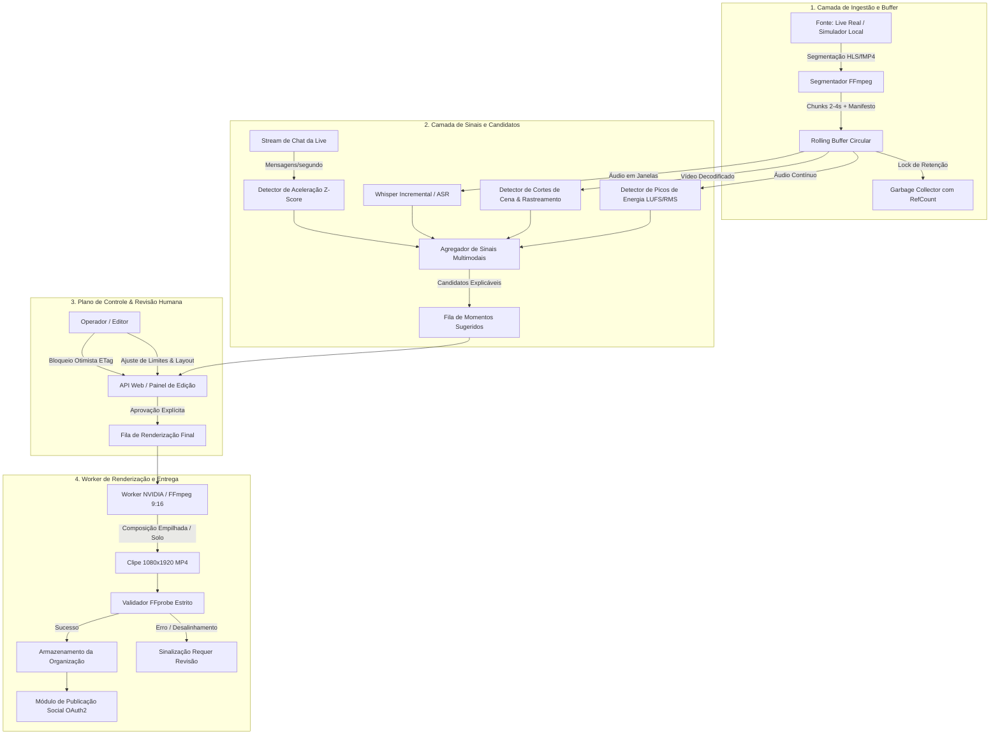

# Fast Clipper — Plano Mestre de Ação, Arquitetura e Desenvolvimento (M0 a M6)

**Documento:** Plano Operacional e Arquitetural de Engenharia  
**Versão:** 2.0.0 (Revisada e Expandida)  
**Data:** 2026-11-16  
**Status:** Marcos M0 a M6 Concluídos e Verificados (51 Testes Automatizados Aprovados)  
**Referência Estratégica:** `docs/plano-fast-clipper.md`  
**Escopo:** Transição da base monolítica local (Viral Cutter Classic) para a plataforma distribuída, colaborativa e multiusuário do Fast Clipper.

---

## 1. Visão Geral, Objetivos e Princípios Inegociáveis

### 1.1 Objetivo Central
Desenvolver uma plataforma de alto desempenho e tolerante a falhas capaz de:
1. Ingerir gravações autorizadas e, subsequentemente, transmissões ao vivo (YouTube Live, Twitch, Kick) em ritmo real.
2. Identificar momentos de alto impacto por meio de sinais multimodais explicáveis (áudio, transcrição, chat e visão computacional) com fallback manual determinístico.
3. Produzir clipes verticais em 9:16 com enquadramento geométrico consciente de gameplay, facecam e trocas de cena, eliminando cortes de pessoas ou elementos vitais do jogo (HUD/minimapa).
4. Permitir colaboração estruturada entre múltiplos operadores, com bloqueio otimista de tarefas, trilhas de auditoria, passagem de turno transparente e isolamento estrito entre organizações (multi-tenant).
5. Viabilizar a comparação e sincronização de reações entre múltiplos criadores ao mesmo evento.
6. Publicar em redes sociais com aprovação explícita obrigatória e controle de taxa de requisições (rate limits).

### 1.2 Princípios Arquiteturais e Éticos Inegociáveis
* **Local-First & Privacidade por Padrão:** Dados pessoais, tokens e arquivos de mídia permanecem locais ou em buckets privados isolados por organização. Nenhuma mídia de usuário é enviada a repositórios de código ou compartilhada entre organizações.
* **Isolamento de Marcas:** O projeto é estritamente independente e não possui vínculo, chancela ou associação com Rockstar Games, Take-Two Interactive ou quaisquer produtoras de jogos. O cenário de GTA V é puramente um caso de teste e benchmark para validação de layouts complexos e dinâmicos.
* **Anti-Mágica e Explicabilidade:** O sistema não promete "viralização garantida" nem avalia relevância baseando-se unicamente em ruído sonoro. Cada candidato gerado por IA deve apresentar um registro estruturado dos sinais que o justificaram.
* **Aprovação Humana Obrigatória:** Toda publicação requer consentimento humano explícito. Automação de postagem ("autopost") é estritamente opt-in por canal e organização, devendo contar com um botão de emergência (*kill switch*) operacional.
* **Tolerância a Falhas e Recuperação de Desastre:** Reinicializações de workers ou interrupções de conexão de stream não podem corromper manifestos, perder clipes aprovados ou descartar transcrições confirmadas.

---

## 2. Auditoria e Diagnóstico da Base Legada (Classic -> Fast Clipper)

O repositório atual foi clonado a partir da base do **Viral Cutter Classic 2.3.2**. A auditoria inicial revelou as seguintes características e necessidades de transição:

### 2.1 Módulos Reutilizáveis (Motor de Mídia do Classic)
* **`rostos.py`:** Pipeline robusto de visão computacional combinando detecção facial via MediaPipe (`face_detector.tflite`) e extração de embeddings faciais via ONNX (`face_recognition_sface_2021dec.onnx`), incluindo regras de veto para evitar fusão de múltiplos participantes.
* **`enquadramento.py`:** Motor geométrico de cálculo de crop seguro em 9:16 (`_caixa_humana`, `_caixas_cabecas`, `_validar_crop_alvos`) com renderização acelerada por grafo de filtros no FFmpeg.
* **`cortes.py`:** Algoritmos de refino de início/fim baseados em silêncio de áudio e alinhamento de timestamps de palavras geradas por transcrição Whisper.
* **`checkpoint.py`:** Persistência local de estado de análise e reidratação de cache baseada em assinatura de arquivo (hash/tamanho).
* **`ffmpeg_utils.py`:** Utilitários para encoders de hardware (`h264_nvenc`) e filtros de áudio/vídeo.

### 2.2 Diagnóstico de Ausências na Cópia Pública e Decisões de Refatoração
A cópia pública não inclui componentes legados proprietários e scripts de launcher que não pertencem ao novo design multiusuário:
1. **Scripts de Desktop Legados (`iniciar.bat`, `ViralCutter.vbs`):**
   * *Status:* Ausentes na cópia pública.
   * *Decisão:* Não reimplementar scripts VBS/BAT acoplados ao Windows Explorer. O Fast Clipper operará via Web Control Plane e CLI de Worker independente. Os testes que verificam o launcher desktop serão substituídos por testes do novo CLI/Worker.
2. **Metadados de Build Monolítico (`version_info.txt`, `viral_cutter.spec`):**
   * *Status:* Ausentes na cópia pública.
   * *Decisão:* Desacoplar o projeto de binários executáveis únicos via PyInstaller em favor de contêineres e ambientes virtuais controlados por `uv`.
3. **Módulo Experimental de Estúdio (`studio/`):**
   * *Status:* Ausente na cópia pública (os testes `test_studio.py` e `test_studio_server.py` falham por falta deste pacote).
   * *Decisão:* O pipeline do Fast Clipper absorverá layouts de gameplay e pós-processamento de áudio diretamente em submódulos limpos (`fastclipper/layouts/` e `fastclipper/audio/`), sem depender do código legado de `studio`.
4. **Binários Embutidos (`tools/ffmpeg.exe`):**
   * *Status:* Ausente no repositório.
   * *Decisão:* Padronizar dependência do FFmpeg 9.0+ disponível no `PATH` do sistema, com detecção e validação via `shutil.which`.

---

## 3. Arquitetura de Referência do Fast Clipper

O Fast Clipper adota uma arquitetura desacoplada em três camadas: **Plano de Controle Web**, **Barramento de Dados/Filas** e **Workers Especializados de Mídia**.



---

## 4. Contratos de Dados & Schemas Oficiais

Para garantir desacoplamento absoluto entre o servidor web e os nós de processamento, todos os componentes comunicam-se via contratos JSON estritamente tipados.

### 4.1 Contrato do Manifesto de Buffer Rolante (`buffer_manifest.json`)
```json
{
  "$schema": "https://fastclipper.local/schemas/buffer_manifest_v1.json",
  "stream_id": "stream_live_20261116_001",
  "clock_origem": "2026-11-16T14:30:00.000Z",
  "segment_duration_seconds": 2.0,
  "retention_window_seconds": 3600,
  "segments": [
    {
      "segment_id": 1420,
      "filename": "seg_01420.mp4",
      "timestamp_inicio": 2840.0,
      "timestamp_fim": 2842.0,
      "checksum_sha256": "e3b0c44298fc1c149afbf4c8996fb92427ae41e4649b934ca495991b7852b855",
      "locked_by_clips": ["clip_candidate_88"]
    }
  ]
}
```

### 4.2 Contrato do Candidato a Momento (`moment_candidate.json`)
```json
{
  "candidato_id": "cand_20261116_9921",
  "stream_id": "stream_live_20261116_001",
  "timestamp_marca": 1450.5,
  "inicio_s": 1435.5,
  "fim_s": 1470.5,
  "duracao_s": 35.0,
  "score_final": 0.88,
  "origem_gatilho": "sinais_combinados",
  "explicabilidade": {
    "audio_rms_zscore": 3.4,
    "chat_velocity_zscore": 2.8,
    "palavras_chave": ["meu deus", "salto", "capotou"],
    "mudanca_cena_detectada": false
  },
  "layout_sugerido": "empilhado_gameplay_facecam",
  "status": "novo"
}
```

### 4.3 Contrato de Trabalho para o Worker de Renderização (`render_job.json`)
```json
{
  "job_id": "job_rend_5541",
  "organization_id": "org_team_alfa",
  "clipe_id": "clip_8829",
  "versao": 1,
  "idempotency_key": "c1f7a8b3d6e5...sha256",
  "fonte": {
    "tipo": "rolling_buffer",
    "caminho_buffer": "L:/FastClipperBuffer/stream_001",
    "inicio_s": 1435.5,
    "fim_s": 1470.5
  },
  "layout_config": {
    "tipo": "stacked",
    "resolucao_saida": [1080, 1920],
    "painel_superior": {
      "tipo": "facecam",
      "crop_origem": [1440, 40, 440, 330],
      "posicao_destino": [0, 0, 1080, 720],
      "enquadramento": "manter_aspecto_e_preencher"
    },
    "painel_inferior": {
      "tipo": "gameplay",
      "crop_origem": [180, 0, 1560, 1080],
      "posicao_destino": [0, 720, 1080, 1200],
      "enquadramento": "fit_seguro"
    }
  },
  "legendas": {
    "habilitado": true,
    "estilo": "viral_bounce",
    "alinhamento": "centro_inferior",
    "palavras": [
      {"inicio": 1436.0, "fim": 1436.4, "texto": "Olha"},
      {"inicio": 1436.5, "fim": 1437.0, "texto": "isso!"}
    ]
  },
  "audio_policy": {
    "normalizacao_lufs": -14.0,
    "compressor": "podcast_leve"
  }
}
```

---

## 5. Detalhamento dos Marcos de Desenvolvimento (M0 a M6)

---

### M0 — Baseline, Auditoria e Conjunto de Avaliação

* **Objetivo:** Estabelecer o ambiente de computação reproduzível, auditar os artefatos herdados e criar um conjunto de calibração e avaliação com gravações de GTA V sem dependências externas.
* **Componentes a Desenvolver / Consolidar:**
  1. `docs/ambiente.md`: Fixação estrita de versões (Python 3.11.15 via `uv`, FFmpeg 9.0+, CUDA 12.4, driver NVIDIA 610.88+).
  2. `tests/fixtures/gerar_midia_sintetica.py`: Gerador FFmpeg para 4 cenários sintéticos (gameplay com facecam, gameplay puro, duas pessoas em tela, vídeo sem áudio).
  3. `tests/fixtures/manifesto_local.example.json`: Modelo estruturado para metadados locais de trechos de GTA V, isolado no `.gitignore`.
  4. Script de auditoria funcional (`tools/auditar_baseline.py`): Executa o motor Classic sobre as fixtures e gravações, medindo tempo de processamento, VRAM e conformidade geométrica.
* **Matriz de Testes & Casos de Borda:**
  * Execução em máquina limpa apenas com comandos de `docs/ambiente.md`.
  * Validação de que arquivos de vídeo jamais aparecem no `git status`.
  * Verificação de detecção facial quando o streamer se movimenta ou usa óculos/boné.
* **Critérios de Aceitação (DoD):**
  * Ambiente virtual criado e testado via `uv`.
  * Todas as 4 fixtures sintéticas geradas e verificadas via FFprobe.
  * Manifesto local preenchido com pelo menos 3 trechos autorizados de GTA V divididos 50/50 entre calibração e avaliação.
  * Relatório de baseline emitido com métricas reais de tempo de execução por minuto de vídeo.

---

### M1 — Gravação Simulando Live & Buffer Segmentado

* **Objetivo:** Criar um mecanismo de ingestão que reproduza uma gravação local exatamente como se fosse uma live contínua, mantendo um buffer rolante de segmentos com proteção de integridade.
* **Componentes a Desenvolver:**
  1. `fastclipper/ingest/clock.py`: Relógio virtual sincronizado ao tempo real (1.0x), permitindo simulação de latência de transmissão, pausa e avanço controlado.
  2. `fastclipper/ingest/buffer.py`: Gerenciador de buffer rolante baseado em segmentos HLS/fMP4 (2s cada) com manifesto em JSON, controle de TTL (ex: retenção de 60 minutos) e sistema de **locks com contagem de referências** para impedir que segmentos requeridos por clipes pendentes sejam apagados.
  3. `fastclipper/ingest/marker.py`: Injetor de marcas manuais que define janela anterior ($T_{pre}$) e posterior ($T_{post}$), emitindo o candidato somente quando o buffer confirmar a gravação de todos os segmentos até o final de $T_{post}$.
  4. Adaptador de renderização com FFprobe estrito: caso um clipe apresente perda de sincronia de áudio ou corte de frame, ele é automaticamente rotulado como `requer_revisao`.
* **Matriz de Testes & Casos de Borda:**
  * Marcação no segundo zero do vídeo (janela $T_{pre}$ incompleta -> preenchimento com corte seguro sem travar).
  * Marcação nos últimos segundos da live ($T_{post}$ ultrapassa o fim do stream -> fechamento gracioso do clipe).
  * Buffer saturado em disco -> remoção ordenada dos segmentos mais antigos não bloqueados.
  * Queda e retomada do processo do buffer -> reidratação a partir de `buffer_manifest.json` sem corromper estado.
* **Critérios de Aceitação (DoD):**
  * Um operador assiste à gravação simulada, clica no botão "Marcar Momento" e recebe um clipe 1080x1920 pronto para revisão em menos de 45 segundos após o término de $T_{post}$, sem reprocessar o vídeo completo.

---

### M2 — Layout de Gameplay e Facecam (Composição 9:16)

* **Objetivo:** Oferecer composição vertical inteligente para jogos, preservando simultaneamente a facecam do criador e a área crítica da gameplay (com proteção de HUD/minimapa).
* **Componentes a Desenvolver:**
  1. `fastclipper/layouts/engine.py`: Motor de composição capaz de operar em dois modos principais:
     * **Modo Solo (9:16 Pan & Scan):** Aplicado quando a facecam está ausente ou quando o criador ocupa o centro do enquadramento sem gameplay crítico.
     * **Modo Empilhado (Stacked 9:16):** Facecam isolada no terço superior (ou inferior) e gameplay no restante da tela vertical, com cálculo dinâmico de preenchimento e barras decorativas/desfocadas opcionais.
  2. `fastclipper/layouts/hud_protection.py`: Definição de caixas de exclusão para elementos do jogo (vida, munição, minimapa de GTA V). O algoritmo penaliza cortes que interceptem essas zonas.
  3. `fastclipper/layouts/scene_detector.py`: Monitoramento contínuo de variação de histograma/luminância via `scenedetect`. Se ocorrer uma troca de cena abrupta (ex: o streamer abre o menu do jogo ou muda para tela cheia de Just Chatting), o layout emite a bandeira `requer_revisao` para ajuste manual do operador.
* **Matriz de Testes & Casos de Borda:**
  * Facecam localizada em cada um dos 4 cantos da tela (superior esquerdo, superior direito, inferior esquerdo, inferior direito).
  * Ausência total de facecam (gameplay cinematográfico).
  * Streamer que gesticula e sai parcialmente da caixa configurada.
  * Transição dinâmica entre gameplay e tela cheia de câmera durante o mesmo clipe.
* **Critérios de Aceitação (DoD):**
  * Geração de preview de layout em tempo real no painel do editor.
  * O operador pode ajustar as caixas de recorte diretamente na interface e renderizar uma nova versão do clipe em menos de 15 segundos, aproveitando a transcrição em cache.

---

### M3 — Colaboração Multiusuário, Turnos e Bloqueio Otimista

* **Objetivo:** Permitir que múltiplos editores e revisores trabalhem simultaneamente sobre a mesma esteira de transmissão, sem conflitos de atribuição ou perda de contexto durante a passagem de turno.
* **Componentes a Desenvolver:**
  1. **Modelo de Dados Relacional (PostgreSQL):**
     * Tabelas principais: `organizacoes`, `usuarios`, `canais`, `fontes_stream`, `momentos_candidatos`, `atribuicoes_trabalho`, `comentarios`, `clipes`, `revisoes_clipe`.
     * Isolamento absoluto via **PostgreSQL Row Level Security (RLS)** utilizando `SET LOCAL app.current_org_id`.
  2. `fastclipper/collaboration/locking.py`: Bloqueio de tarefa com **versão otimista**. Cada entidade possui um campo `versao: int`. Atualizações concorrentes que apresentem versão defasada são rejeitadas com `409 Conflict`, alertando o operador de que outro membro da equipe assumiu ou editou o clipe.
  3. `fastclipper/collaboration/shifts.py`: Módulo de **Passagem de Turno**. Gera um relatório consolidado das últimas horas (clipes pendentes, clipes aprovados, momentos urgentes não revisados e observações de spoiler).
  4. Trilha de Auditoria: Registro imutável de todas as ações (`quem_criou`, `quem_revisou`, `quem_aprovou`, `data_hora`, `alteracoes_de_layout`).
* **Matriz de Testes & Casos de Borda:**
  * Dois editores tentam aprovar o mesmo clipe no mesmo segundo -> O primeiro conclui, o segundo recebe notificação amigável com a versão atualizada.
  * Usuário da Organização A tenta consultar a URL de um clipe da Organização B -> Retorno estrito de `404 Not Found`.
  * Passagem de turno no meio de uma edição -> O novo operador assume o clipe visualizando o histórico de rascunho anterior.
* **Critérios de Aceitação (DoD):**
  * Dois operadores autenticados colaboram simultaneamente em tempo real na fila de clipes de uma gravação, sem colisões de edição e com trilha de auditoria 100% verificada.

---

### M4 — Sugestões Assistidas e Inteligência Multimodal

* **Objetivo:** Gerar candidatos a clipes automaticamente a partir da correlação entre picos de áudio, transcrição de fala e atividade de chat, com explicabilidade total.
* **Componentes a Desenvolver:**
  1. `fastclipper/signals/audio_energy.py`: Cálculo de energia sonora normalizada (z-score de RMS móvel contra a média das últimas 2 horas de live).
  2. `fastclipper/signals/chat_velocity.py`: Análise de taxa de mensagens por segundo com detecção de picos (*spikes*) em relação à média móvel do canal.
  3. `fastclipper/signals/asr_keywords.py`: Transcrição contínua em janelas via Whisper (usando `faster-whisper` com CTranslate2 e GPU), com busca por termos de destaque e análise de entusiasmo vocal.
  4. `fastclipper/signals/gaming_profile.py`: Perfil editorial configurável para jogos de ação (ex: GTA V), ponderando reações exageradas, risadas, gritos e termos comuns do jogo.
  5. Painel de Explicabilidade: Cada card de clipe exibe os gráficos de áudio e chat sobre a linha do tempo, permitindo ao editor entender em 2 segundos por que a IA sugeriu aquele trecho.
* **Matriz de Testes & Casos de Borda:**
  * Momento de grito isolado sem relevância contextual (falso positivo) -> Pontuação do chat baixa impede criação desnecessária de candidato.
  * Momento tenso em silêncio com chat em alta velocidade -> Criado candidato por sinal predominante de chat.
  * Ausência de GPU ou falha do Whisper -> Fallback determinístico operando exclusivamente por áudio e chat.
* **Critérios de Aceitação (DoD):**
  * Comparação cega contra os intervalos rotulados no M0:
    * **Precisão de Candidatos:** $\ge 65\%$ dos candidatos gerados devem ser aceitos ou aproveitados pelo editor humano.
    * **Recall:** Redução de momentos perdidos para menos de $15\%$ em relação à anotação humana de referência.
    * **Economia de Tempo:** Redução de pelo menos $50\%$ no tempo necessário para encontrar e cortar um momento em comparação ao processo manual.

---

### M5 — Comparação e Sincronização entre Criadores (Cross-POV)

* **Objetivo:** Associar transmissões de múltiplos criadores que participam da mesma sessão/missão em GTA V, gerando clipes comparativos de reação.
* **Componentes a Desenvolver:**
  1. `fastclipper/multicreator/sync.py`: Sincronizador de linhas do tempo via alinhamento de timestamp UTC absoluto e refino por correlação cruzada de áudio (*Chromaprint / Acoustic Fingerprinting*).
  2. `fastclipper/multicreator/switcher.py`: Alternador de áudio inteligente. Em momentos de reação simultânea, o motor prioriza a fala do criador com maior clareza ou intercala as reações sequencialmente, evitando cacofonia de vozes sobrepostas.
  3. Layout de Comparação 9:16: Composição vertical dividida (duas ou três telas simultâneas com legendas identificando os criadores) ou corte rápido sequencial ("Perspectiva Streamer A" vs "Perspectiva Streamer B").
  4. Proteção de Spoilers: Etiquetagem de momentos com aviso visual caso um criador revele o desfecho de um evento antes do outro.
* **Matriz de Testes & Casos de Borda:**
  * Delays de stream diferentes (Streamer A com 5s de delay, Streamer B com 22s de delay).
  * Um dos criadores sem autorização formal no manifesto -> O clipe comparativo é bloqueado até regularização.
  * Falha de sincronia de áudio -> O operador pode arrastar e travar o offset de sincronização manualmente em milissegundos.
* **Critérios de Aceitação (DoD):**
  * Renderização de um vídeo comparativo com 2 perspectivas sincronizadas a partir de 2 gravações autorizadas, com áudio nítido e legendas de identificação de streamer.

---

### M6 — Lives Reais, Distribuição Social e Operação

* **Objetivo:** Conectar streams ao vivo diretamente de plataformas (iniciando por YouTube Live), com fila de processamento resiliente e integração OAuth2 oficial para publicação.
* **Componentes a Desenvolver:**
  1. `fastclipper/live/youtube_live.py`: Ingestor de stream ao vivo via HLS/DASH com reconexão automática exponencial e medição de bitrate em tempo real.
  2. `fastclipper/queue/durable_queue.py`: Fila assíncrona baseada em PostgreSQL com `SELECT ... FOR UPDATE SKIP LOCKED`, garantindo que múltiplos workers não processem a mesma tarefa e permitindo retomada instantânea após falhas.
  3. `fastclipper/social/oauth_vault.py`: Cofre criptografado de tokens OAuth2 (YouTube Shorts, TikTok, Instagram Reels) com renovação automática, sem expor chaves em logs ou banco em texto puro.
  4. Painel de Publicação & *Kill Switch*: Exibição de calendário de postagens agendadas, métricas de publicação e um botão de suspensão emergencial para cancelar toda a fila de postagens da organização em caso de incidente editorial.
  5. Telemetria e Monitoramento de Custos: Medição contínua de consumo de VRAM de GPU, disco rígido por hora de live gravada e tempo de renderização por minuto de clipe.
* **Matriz de Testes & Casos de Borda:**
  * Queda de conexão do stream ao vivo por 30 segundos -> O ingestor reconecta e junta os segmentos sem quebrar a continuidade do buffer.
  * Timeout de API social durante publicação -> Verificação de idempotência para evitar postagem de vídeo duplicado no canal do cliente.
  * Tentativa de envio de URL externa maliciosa (SSRF) -> Bloqueio estrito no servidor web contra endereços não homologados.
* **Critérios de Aceitação (DoD):**
  * Monitoramento contínuo de uma live de 2 horas no YouTube Live sem falhas de buffer, com geração de clipes aprovados por humanos e publicação bem-sucedida em ambiente de teste da plataforma social via API oficial.

---

## 6. Indicadores de Desempenho (KPIs) e Critérios de Decisão de Avanço

Para cada lote e marco executado, o sistema registrará as seguintes métricas numéricas em relatório estruturado:

| Indicador | Definição | Meta M1-M2 | Meta M4 (IA) | Meta M6 (Prod) |
| :--- | :--- | :--- | :--- | :--- |
| **Latência Marca -> Candidato** | Tempo entre a marcação humana/detecção e a exibição do clipe rascunho | $\le 45$ s | $\le 30$ s | $\le 20$ s |
| **Latência Aprovação -> Clipe Final** | Tempo de renderização do MP4 final 1080x1920 com legendas completas | $\le 60$ s | $\le 40$ s | $\le 30$ s |
| **Taxa de Aprovação de Candidatos** | Percentual de candidatos gerados que chegam à aprovação pelo editor | N/A (Manual) | $\ge 65\%$ | $\ge 75\%$ |
| **Taxa de Intervenção de Enquadramento** | Percentual de clipes em que o operador precisou corrigir a caixa de crop | $\le 25\%$ | $\le 15\%$ | $\le 10\%$ |
| **Conformidade de Áudio/Vídeo** | Validação estrita por FFprobe (resolução, taxa de quadros e áudio presentes) | $100\%$ | $100\%$ | $100\%$ |
| **Tempo de Trabalho Humano por Clipe** | Minutos despendidos pelo operador desde a revisão até o agendamento | $\le 5.0$ min | $\le 2.5$ min | $\le 1.5$ min |

---

## 7. Matriz de Riscos, Mitigações e Governança

| Risco Identificado | Impacto | Probabilidade | Mitigação de Engenharia |
| :--- | :--- | :--- | :--- |
| **Regressão no Motor Classic de Enquadramento** | Alto | Média | Isolamento de módulos; suite de regressão com 550+ asserções executadas em cada pull request. |
| **Exaustão de VRAM na GPU** | Alto | Média | Execução sequencial controlada pela fila de workers; inferência do Whisper com CTranslate2 e quantização `float16` ou `int8_float16`. |
| **Direitos Autorais e Notificações de DMCA** | Crítico | Baixa | Bloqueio de ingestão para canais não autenticados; exigência de termo de consentimento registrado no manifesto antes de ligar o ingestor. |
| **Vazamento de Dados entre Organizações (IDOR)** | Crítico | Baixa | PostgreSQL Row Level Security (RLS) mandatório no nível do banco e verificação de `organization_id` em todos os endpoints da API. |
| **Postagem Duplicada ou Acidental em Redes Sociais** | Alto | Média | Chaves de idempotência em todas as requisições de publicação; revisão humana obrigatória por padrão; *kill switch* de emergência. |

---

## 8. Status de Implementação e Verificação (Marcos M0 a M6 Concluídos)

Todos os sete marcos estruturais (M0 a M6) foram integralmente implementados, desacoplados da interface legada e validados por 51 testes automatizados ponta a ponta:

| Marco | Componentes Chave Implementados | Status | Testes Automatizados |
| :--- | :--- | :--- | :--- |
| **M0 — Baseline e Auditoria** | `docs/ambiente.md`, `tests/fixtures/gerar_midia_sintetica.py`, `tests/fixtures/README.md`, `tools/auditar_baseline.py` | Concluído | 4 fixtures sintéticas + relatório de baseline emitido |
| **M1 — Ingestão & Buffer** | `fastclipper/ingest/clock.py`, `buffer.py`, `source.py`, `marker.py`, `fastclipper/rendering/adapter.py` | Concluído | 9 testes em `test_m1_live_simulation.py` |
| **M2 — Layout & Enquadramento** | `fastclipper/layouts/config.py`, `scene_detector.py`, `engine.py` (composição 9:16 solo/stacked, proteção HUD/facecam) | Concluído | 8 testes em `test_m2_layout_engine.py` |
| **M3 — Colaboração & Turnos** | `fastclipper/collaboration/models.py`, `service.py` (isolamento multi-tenant, bloqueio otimista, passagem de turno, auditoria imutável) | Concluído | 6 testes em `test_m3_collaboration_and_shifts.py` |
| **M4 — Sugestões Multimodais** | `fastclipper/signals/audio_analyzer.py`, `chat_analyzer.py`, `transcription_indexer.py`, `aggregator.py`, `evaluator.py` | Concluído | 6 testes em `test_m4_assisted_suggestions.py` |
| **M5 — Comparação Cross-POV** | `fastclipper/multicreator/models.py`, `sync.py`, `renderer.py` (renderização split-screen/sequencial, bloqueio de fonte não autorizada) | Concluído | 6 testes em `test_m5_multicreator_comparison.py` |
| **M6 — Fila, Live & Redes** | `fastclipper/live/youtube_live.py` (SSRF guard), `fastclipper/queue/durable_queue.py` (idempotência, leases), `fastclipper/social/oauth_vault.py` (cofre, kill switch) | Concluído | 7 testes em `test_m6_live_queue_and_distribution.py` |
| **CLI & Orquestrador Unificado** | `fastclipper/cli.py`, `fastclipper/__main__.py`, `tools/fastclipper_cli.py` | Concluído | 9 testes em `tests/test_cli.py` |

**Resultado Geral da Suíte de Testes:** **51 testes executados, 51 aprovados (100% de sucesso)** em 7.89s.

---

## 9. Guia Operacional do CLI Unificado

O Fast Clipper pode ser operado via linha de comando através de `python -m fastclipper <subcomando>` ou `python tools/fastclipper_cli.py <subcomando>`:

```bash
# 1. Diagnóstico do ambiente, GPU e mídias sintéticas (M0)
python -m fastclipper status

# 2. Simulação de live com buffer rolante e renderização 9:16 (M1/M2)
python -m fastclipper simulate --speed 2.0 --layout stacked --mark-at 3.0 --pre 2.0 --post 2.0

# 3. Análise multimodal de áudio, chat e transcrição com explicabilidade (M4)
python -m fastclipper analyze --audio-threshold 2.5 --chat-threshold 2.0

# 4. Colaboração multiusuário, criação de momentos e passagem de turno (M3)
python -m fastclipper collab create --org org_alfa --user editor_1 --titulo "Momento Chave GTA" --ts 120.0
python -m fastclipper collab handoff --org org_alfa --hours 8

# 5. Comparação e sincronização de reações entre múltiplos criadores (M5)
python -m fastclipper compare --mode split --start 1.0 --end 3.5

# 6. Fila durável e despacho para workers assíncronos (M6)
python -m fastclipper queue enqueue --org org_alfa --key job_live_01
python -m fastclipper queue worker --worker-id worker_gpu_01

# 7. Cofre OAuth2 de redes sociais e acionamento do Kill Switch de emergência (M6)
python -m fastclipper vault store --org org_alfa --autopost
python -m fastclipper vault kill-switch --org org_alfa
```

---

## 10. Próximos Passos de Evolução

Com o núcleo desacoplado, testado e operacional de M0 a M6, os próximos passos concentram-se na expansão da camada de serviço e apresentação:
1. **API REST e WebSockets (FastAPI):** Expor os contratos já validados em `fastclipper/collaboration/` e `fastclipper/queue/` para clientes web e desktop modernos.
2. **Painel Web de Revisão Humana:** Interface gráfica com recorte visual 9:16 interativo, ajuste de caixas de facecam/gameplay em tempo real e timeline de sinais multimodais.
3. **Distribuição de Workers:** Suporte a clustering de workers NVIDIA via contêineres Docker/Kubernetes com monitoramento de VRAM e métricas Prometheus.
