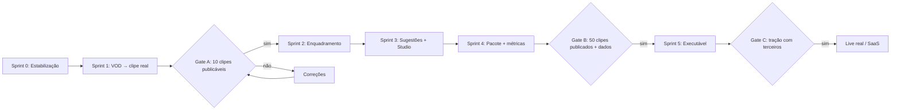

# Fast Clipper — Auditoria Técnica e Plano Mestre v3

**Versão:** 3.0 · **Data:** 2026-11-16 · **Base auditada:** commit `1430268` (branch `main`)
**Substitui:** `docs/plano-fast-clipper.md` (v1, visão SaaS) e `docs/plano-equipes-gta-v.md` (v2, marcos M0–M6)
**Objetivo de negócio vigente:** gerar receita produzindo clipes **localmente**, na máquina da equipe. Executável para terceiros e SaaS só depois que o fluxo local der resultado comprovado.

---

## 1. Veredito executivo

A base tem bons componentes isolados (validação estrita com FFprobe, fallback de encoder, grafos de layout 9:16, gerador ASS com anti-blink, pre-check de mídia) e um motor Classic com capacidades reais (faster-whisper, yt-dlp, detecção facial). **Mas o produto, como está hoje, não produz um clipe pronto para publicar a partir de um vídeo real.** Os três motivos principais:

1. **A legenda não acompanha a fala.** O texto é distribuído em intervalos iguais e, quando o corte não começa no segundo 0, a legenda fica fora do clipe (some).
2. **Não existe transcrição nem download no ambiente atual.** O `.venv` não tem `faster-whisper`, `yt-dlp`, `torch`, `opencv` nem `mediapipe`.
3. **O layout empilhado usa uma posição fixa de facecam** (`x=50, y=50, 400×300`), que não corresponde a nenhuma live real.

Além disso, várias afirmações dos planos anteriores e dos relatórios de progresso **exageram o estado real** (fila "durável" em memória, cofre "criptografado" em base64, ingestão "live" simulada, "94 testes" obtidos com uma lista de arquivos que deixa de fora os testes que falham). O plano v2 otimizava para uma plataforma multiusuário, que **não é** o objetivo atual.

**Recomendação:** congelar o escopo SaaS, corrigir os problemas P0 em 1–2 dias e investir 4 sprints curtos num único fluxo que gere dinheiro: **VOD → transcrição → sugestão de momentos → revisão → clipe 9:16 com legenda sincronizada → pacote de publicação → medição de resultado.**

---

## 2. Achados da auditoria

Gravidade: **P0** bloqueia receita ou causa dano · **P1** compromete qualidade ou confiabilidade · **P2** dívida técnica ou de processo.

### 2.1 P0 — Bloqueadores

| ID | Achado | Evidência | Impacto |
|---|---|---|---|
| A1 | **Legenda com tempo absoluto num clipe que começa em 0.** O FFmpeg corta com `-ss` antes de `-i`, o que zera a linha do tempo do clipe, mas os tempos das palavras são `inicio_s + i·passo`. Com início = 120 s, a legenda começa em 120 s num clipe de 30 s e não aparece. Os testes passam só porque usam `inicio_s=0.0`. | [app.py#L384-L405](file:///L:/Fast-Clipper-Publico/fastclipper/api/app.py#L384-L405), [pipeline_runner.py](file:///L:/Fast-Clipper-Publico/fastclipper/rendering/pipeline_runner.py) | O clipe sai sem legenda, o principal ativo de retenção. |
| A2 | **Legenda "falsa".** As palavras são espalhadas uniformemente pela duração, sem reconhecimento de fala. | [app.py#L394](file:///L:/Fast-Clipper-Publico/fastclipper/api/app.py#L394) | Legenda dessincronizada parece amadora e derruba a retenção. |
| A3 | **Sem transcrição nem download no ambiente.** O Classic tem `faster-whisper` ([analise.py](file:///L:/Fast-Clipper-Publico/analise.py)) e `yt-dlp` ([download_video.py](file:///L:/Fast-Clipper-Publico/download_video.py)), mas o pacote `fastclipper` não os usa e o `.venv` não tem essas dependências. | `find_spec` → `faster_whisper/yt_dlp/torch/cv2/mediapipe = False` | O fluxo completo é impossível sem trabalho manual externo. |
| A4 | **Facecam fixa no layout empilhado.** | [app.py#L1019](file:///L:/Fast-Clipper-Publico/fastclipper/api/app.py#L1019) | Corte errado em qualquer live real. |
| A5 | **Segurança do servidor local.** CORS `*` com `allow_credentials=True`, e `/studio/render-now` aceita **qualquer caminho do disco**. Qualquer site aberto no navegador pode disparar requisições para `127.0.0.1:8000`. | [app.py#L44-L50](file:///L:/Fast-Clipper-Publico/fastclipper/api/app.py#L44-L50) | Leitura e processamento de arquivos arbitrários a partir de páginas maliciosas (CSRF / DNS rebinding). |
| A6 | **Métrica de testes enganosa.** O `pytest.ini` usa uma lista de arquivos (`python_files`) que deixa de fora os testes do Classic. Sem a lista: **127 testes coletados e 6 arquivos com erro de coleta** (`test_core`, `test_enquadramento_seguro`, `test_fast_export`, `test_interface_detection`, `test_participantes_distintos`, `test_studio_server`). | [pytest.ini](file:///L:/Fast-Clipper-Publico/pytest.ini) | Falsa sensação de saúde: "94/94" não mede o produto. |
| A7 | **Regressão causada pelo agente:** o commit `1430268` sobrescreveu `tests/test_studio.py`, que continha a especificação do módulo `studio/` do Classic (voice enhancer, LUT, zoom, barra de progresso, layouts inteligentes). | `git show ad70b91:tests/test_studio.py` | Perda de especificação de funções que vendem clipe. Recuperável pelo histórico. |
| A8 | **Trabalho não salvo fora da máquina:** 7 commits estão apenas locais (`ahead 7` de `origin/main`). | `git status -sb` | Risco de perder todo o trabalho em caso de falha de disco. |

### 2.2 P1 — Qualidade e confiabilidade

| ID | Achado | Evidência |
|---|---|---|
| B1 | **"DurableTaskQueue" não é durável:** é um `dict` em memória e a flag `--db` é ignorada. O mesmo vale para o `CollaborationService`. Tudo se perde ao reiniciar. | [durable_queue.py#L62](file:///L:/Fast-Clipper-Publico/fastclipper/queue/durable_queue.py#L62) |
| B2 | **"Cofre OAuth criptografado" usa base64 + hash**, o que não é criptografia. Não pode receber token real. | [oauth_vault.py#L85](file:///L:/Fast-Clipper-Publico/fastclipper/social/oauth_vault.py#L85) |
| B3 | **A ingestão "live" é um stub:** `connect()` devolve 4500 kbps / 60 fps fixos e não captura nada. O M1 é uma simulação a partir de arquivo local. | [youtube_live.py#L97-L119](file:///L:/Fast-Clipper-Publico/fastclipper/live/youtube_live.py#L97-L119) |
| B4 | **Ambiente não reprodutível:** `requirements.txt` não lista `fastapi/uvicorn/httpx` e lista `gradio/pywebview/pyinstaller` do Classic. Uma instalação limpa não sobe o Studio. | [requirements.txt](file:///L:/Fast-Clipper-Publico/requirements.txt) |
| B5 | **Dois aplicativos e dois caminhos de render duplicados:** scripts Classic na raiz + pacote `fastclipper`; `adapter.py` e `pipeline_runner._render_ffmpeg_direct` repetem a mesma lógica de FFmpeg e fallback. | [adapter.py](file:///L:/Fast-Clipper-Publico/fastclipper/rendering/adapter.py) |
| B6 | **UX do Studio inadequada para volume:** caminho digitado à mão, sem prévia da fonte, sem timeline nem forma de onda, sem marcação por teclado, sem render em lote. | Dashboard em `app.py` |
| B7 | **Cerca de 600 linhas de HTML/CSS/JS dentro de uma string Python**, sem testes de interface. | `app.py` |

### 2.3 P2 — Escopo, processo e conformidade

| ID | Achado |
|---|---|
| C1 | **Escopo prematuro:** multi-tenant, RBAC, turnos, Cross-POV e autopost consomem esforço sem relação com a receita local. |
| C2 | **Documentos contraditórios:** o v2 decidiu "não reimplementar .bat" e o `iniciar.bat` foi criado depois; o status "M0–M6 concluídos" não distingue protótipo de produção. |
| C3 | **Licenças na distribuição:** o FFmpeg usado (build gyan.dev com `--enable-gpl`, `libx264`) é GPL. Empacotar no executável exige conformidade GPL ou outro build. |
| C4 | **Direitos e políticas de plataforma:** clipar terceiros sem autorização gera remoção e strikes, e plataformas de vídeo curto restringem a monetização de conteúdo reutilizado sem transformação. O produto precisa registrar a autorização por fonte e favorecer edição com valor agregado (legenda, gancho, contexto). |

### 2.4 O que está sólido e deve ser preservado

- `rendering/adapter.validate_media_ffprobe` (resolução, áudio, duração, decodificação completa).
- `rendering/encoder.HardwareEncoderManager` (NVENC/QSV com fallback para libx264).
- `layouts/engine.build_filter_graph` (solo e empilhado) e `generate_preview`.
- `subtitles/engine` (chunking vertical, anti-blink, ASS/SRT, presets).
- `ingest/precheck`, `signals/*` (picos de áudio, chat em z-score, boundaries, clustering).
- Classic: `analise.py` (faster-whisper), `download_video.py` (yt-dlp), `rostos.py` / `enquadramento.py` (detecção facial e crop seguro), `checkpoint.py` (cache por assinatura de arquivo).

---

## 3. Reposicionamento estratégico

### 3.1 Princípios

1. **Receita antes de plataforma.** Cada sprint precisa aumentar *clipes publicáveis por hora de trabalho humano*.
2. **Local primeiro e monousuário.** Um processo, SQLite, pastas por projeto. Sem multi-tenant, sem OAuth, sem autopost.
3. **Reaproveitar antes de reescrever.** O motor Classic é a fonte de transcrição, download e detecção facial, ligada ao `fastclipper` por adaptadores.
4. **Honestidade de métricas.** O estado é reportado por capacidade verificada com vídeo real, não pela contagem de testes.
5. **Portões de decisão (gates).** Executável e SaaS só avançam com dados de resultado.

### 3.2 Fluxo-alvo de receita (MVP local)

### 3.3 Arquitetura-alvo local

| Camada | Decisão | Motivo |
|---|---|---|
| Processo | FastAPI + 1 worker em thread no mesmo processo | Simples de rodar e empacotar |
| Persistência | **SQLite (WAL)** em `data/fastclipper.db`: projetos, fontes, transcrições, sugestões, clipes, jobs, resultados | Durável, sem servidor, migrável para PostgreSQL |
| Arquivos | `data/projects/<projeto>/{source,cache,clips,exports}` | Organização e limpeza fáceis |
| Transcrição | Adaptador `fastclipper/transcribe/` reaproveitando `analise._transcrever_faster_whisper`, com cache por hash do arquivo | Reuso do código já validado |
| Render | **Um único** caminho de render (`rendering/render_core.py`), usado pelo Studio e pela fila | Elimina a duplicação de B5 |
| Interface | HTML/JS em `fastclipper/web/` (arquivos estáticos), servido pelo FastAPI | Manutenível e testável |
| Segurança | Bind em `127.0.0.1`, sem CORS, checagem do header `Host`, token por sessão, pastas de entrada permitidas | Fecha A5 |

Módulos **congelados** (mantidos e testados, mas sem novos investimentos até o Gate C): `collaboration/`, `multicreator/`, `social/`, `live/`, `queue/` (exceto a migração para SQLite).

---

## 4. Plano de execução detalhado

Premissas: 1 desenvolvedor + agente, sprints de 5 dias úteis, GPU NVIDIA disponível (a confirmar). As datas são estimativas a partir de 2026-11-16.

### Sprint 0 — Estabilização e verdade da base (1–2 dias · 16–17/11)

| # | Tarefa | Critério de aceite |
|---|---|---|
| 0.1 | Corrigir A1: tempos de legenda **relativos ao início do clipe** no Studio e no `PipelineRunner` | Teste com `inicio_s=5.0` gera ASS com primeiro evento < 1 s e frame com legenda visível (comparação de pixels na região da legenda) |
| 0.2 | Fechar A5: remover CORS, validar `Host`, aceitar entrada só de pastas configuradas, sanitizar `filename` | Testes de requisição cross-origin e de caminho fora da pasta permitida → 403 |
| 0.3 | Restaurar a especificação perdida (A7) em `tests/legacy/test_studio_classic.py`, com `skip` explícito enquanto `studio/` não existir | O arquivo volta ao repositório, e os skips aparecem no relatório |
| 0.4 | Acabar com a lista de arquivos do `pytest.ini` (A6): rodar **todos** os testes; os que dependem de pacotes pesados recebem `pytest.importorskip` e o marcador `@pytest.mark.heavy` | `pytest` sem filtro: 0 erros de coleta; o relatório mostra passed/skipped reais |
| 0.5 | Ambiente reprodutível (B4): `pyproject.toml` com extras `[studio]`, `[transcribe]`, `[vision]`, `[dev]`; `iniciar.bat` verifica as dependências e orienta a instalação | Uma instalação limpa num venv novo sobe o Studio com 1 comando |
| 0.6 | Instalar `faster-whisper` e `yt-dlp` no `.venv` e validar CUDA | `python -m fastclipper status` mostra GPU, CUDA e modelos |
| 0.7 | Push para o GitHub (A8), **com autorização do usuário** | `origin/main` atualizado |
| 0.8 | Renomear ou rotular a fila e o cofre como protótipos (B1, B2) na documentação e no código | Nenhuma afirmação de "durável" ou "criptografado" sem implementação real |

### Sprint 1 — Do VOD real ao clipe com legenda real (5 dias · 18–24/11)

| # | Tarefa | Critério de aceite |
|---|---|---|
| 1.1 | Persistência SQLite (projetos, fontes, jobs, clipes) e migração da fila para SQLite com lease | Reiniciar o processo no meio de um job → o job é retomado ou falha de forma explícita; nada se perde |
| 1.2 | Ingestão: seletor/upload de arquivo + URL via `yt-dlp`, com campo obrigatório "referência de autorização" | VOD de 1 h baixado ou importado, pre-check aprovado, metadados salvos |
| 1.3 | Transcrição `faster-whisper` com timestamps por palavra, cache por hash e barra de progresso | 1 h de áudio transcrita; a segunda abertura usa o cache (< 2 s) |
| 1.4 | Legendas a partir dos timestamps reais; edição de texto preservando os tempos; quebra em 2–4 palavras | Erro médio de sincronia ≤ 150 ms numa amostra anotada manualmente (20 frases) |
| 1.5 | Unificar o render (B5) em `render_core.py` | Studio e fila chamam a mesma função; testes de ambos passam |

**Gate A (fim do Sprint 1):** a partir de 3 VODs reais e autorizados, produzir **10 clipes que a equipe publicaria sem retoque externo**. Se não passar, o Sprint 2 é dedicado a corrigir as falhas encontradas.

### Sprint 2 — Enquadramento correto (5 dias · 25/11–01/12)

| # | Tarefa | Critério de aceite |
|---|---|---|
| 2.1 | Endpoint de frame de prévia (reusa `generate_preview`) e desenho do retângulo de facecam/gameplay sobre o frame | O usuário define a facecam em < 15 s |
| 2.2 | Detecção automática de facecam (adaptador sobre `rostos.py`/MediaPipe) como sugestão inicial | Acerto ≥ 80 % no conjunto de referência (IoU ≥ 0,5) |
| 2.3 | Presets por canal salvos no SQLite | O segundo VOD do mesmo canal já abre com o layout correto |
| 2.4 | Conjunto de referência (golden set): 5–10 amostras reais autorizadas fora do Git, com manifesto local (`manifesto_local.example.json` já existe) | Testes `@pytest.mark.golden` rodam localmente e geram relatório com miniaturas |

### Sprint 3 — Sugestão de momentos e Studio produtivo (5 dias · 02–08/12)

| # | Tarefa | Critério de aceite |
|---|---|---|
| 3.1 | Ranking de momentos a partir de `signals/` (picos de áudio + palavras-chave da transcrição + chat quando houver log), com explicação | Em 3 VODs, ≥ 50 % dos 10 primeiros sugeridos são aprovados pela equipe |
| 3.2 | Ajuste de limites por frase (`boundaries.py`), para nunca cortar no meio de uma palavra | 0 cortes no meio de palavra no golden set |
| 3.3 | Timeline com forma de onda, atalhos (I/O, J/K/L, Enter = renderizar) e fila de render em lote com progresso | Tempo humano por clipe aprovado ≤ 3 min (meta) |
| 3.4 | Interface extraída para `fastclipper/web/` (B7) | `app.py` fica só com rotas |

### Sprint 4 — Pacote de publicação e métricas de negócio (5 dias · 09–15/12)

| # | Tarefa | Critério de aceite |
|---|---|---|
| 4.1 | Exportação por clipe: mp4, `.srt`, título, descrição, hashtags e capa (frame escolhido + texto) | Pasta `exports/<data>/<clipe>/` pronta para upload |
| 4.2 | Geração opcional de título, descrição e gancho por LLM (o SDK `anthropic` já está nas dependências), com fallback por modelo de texto | Funciona offline sem LLM |
| 4.3 | Registro de resultados: plataforma, link, views em 24 h / 7 d, receita; painel por formato, preset e canal | A equipe decide o próximo formato com base em dados |
| 4.4 | Extras de retenção priorizados pelos dados: barra de progresso, zoom de ênfase, melhoria de voz (especificação restaurada em 0.3) | Cada extra com teste e toggle |

**Gate B (fim do Sprint 4):** ≥ 50 clipes publicados, com dados de views/receita registrados e o custo de tempo por clipe medido. Decide se vale empacotar para terceiros.

### Sprint 5 — Executável distribuível (5–8 dias · após o Gate B)

| # | Tarefa | Critério de aceite |
|---|---|---|
| 5.1 | Empacotamento onedir (PyInstaller ou Nuitka), FFmpeg com estratégia de licença definida (C3), download de modelos na primeira execução | Instala e roda numa máquina Windows limpa |
| 5.2 | Detecção de hardware e perfis (GPU / CPU) | Funciona sem NVIDIA (mais lento, mas funciona) |
| 5.3 | Logs, relatório de erro anônimo opcional, verificador de atualização | Diagnóstico remoto sem acesso à máquina |
| 5.4 | Termos de uso com obrigação de autorização da fonte | Aceite registrado na primeira execução |

### Fase futura (só após o Gate C, com tração comprovada)

Live real (captura HLS via `yt-dlp`/`streamlink` com buffer segmentado), multiusuário, PostgreSQL, publicação via API oficial com OAuth e criptografia real (KMS/DPAPI). O código atual de `live/`, `collaboration/`, `multicreator/` e `social/` serve como protótipo de referência.

---

## 5. Indicadores (KPIs)

| Indicador | Como medir | Meta inicial |
|---|---|---|
| Tempo humano por clipe aprovado | Cronômetro no Studio (da abertura do projeto à exportação) | ≤ 3 min |
| Tempo VOD 1 h → primeiros 5 clipes | Log de jobs | ≤ 20 min com GPU |
| Taxa de aprovação de sugestões | Aprovados / top-10 sugeridos | ≥ 50 % |
| Sincronia de legenda | Amostra anotada | ≤ 150 ms de erro médio |
| Falhas de render | Jobs que falharam / total | < 2 % |
| Resultado por clipe | Views em 7 d e receita (registro manual) | Linha de base no Sprint 4 |

---

## 6. Riscos e mitigação

| Risco | Prob. | Impacto | Mitigação |
|---|---|---|---|
| Uso de conteúdo sem autorização → remoções e strikes | Média | Crítico | Campo de autorização obrigatório por fonte; foco em parcerias e campanhas autorizadas |
| Restrição de monetização por conteúdo reutilizado | Média | Alto | Legenda, gancho e contexto editorial; nunca repostar o trecho cru |
| Dependências pesadas (torch/CUDA) quebram o ambiente | Alta | Médio | Extras separados, `importorskip`, verificação no `iniciar.bat` |
| Volta da expansão de escopo (SaaS, live) | Alta | Alto | Módulos congelados e gates formais |
| Perda de dados ou trabalho | Média | Alto | Push diário; `data/` fora do Git com backup |
| Métricas otimistas encobrindo defeitos | Média | Alto | Testes com vídeo real (golden) e relatório de skips obrigatório |
| GPL do FFmpeg na distribuição | Baixa agora | Alto depois | Decisão de licença antes do Sprint 5 |

---

## 7. Estratégia de testes revisada

1. **Unitários** (rápidos, em CI): tempos de legenda, grafos de filtro, estados da fila, sanitização de caminhos.
2. **Integração com FFmpeg** (fixtures sintéticas): render, validação FFprobe, queima de legenda **com início ≠ 0**.
3. **Golden set com vídeo real** (local, `@pytest.mark.golden`): sincronia de legenda, IoU da facecam, cortes no meio de palavra. Gera relatório com miniaturas.
4. **Segurança**: cross-origin, path traversal, header `Host`.
5. **Sem lista de arquivos**: todo teste coletado aparece como passed, failed ou skipped com motivo. O relatório de progresso sempre informa os três números.
6. **CI** (GitHub Actions, CPU): unitários + integração com FFmpeg a cada push, a partir do Sprint 1.

---

## 8. Governança

- **Definição de pronto (DoD):** código + teste + funcionamento verificado com **vídeo real** + documentação atualizada + commit **e push**.
- **ADRs curtos** em `docs/adr/` para decisões estruturais (SQLite, render único, congelamento de módulos, licença do FFmpeg).
- **Relatório de status** no formato "capacidade verificada / protótipo / ausente", nunca só a contagem de testes.

---

## 9. Decisões registradas e pendentes

1. **Modelo de receita prioritário:** *(pendente)* campanhas de clipping pagas por visualização, serviço pago para streamers, ou canais próprios com conteúdo licenciado.
2. **Plataformas de publicação (confirmado):** TikTok, YouTube Shorts, Instagram Reels e YouTube (1080×1920 vertical para curtos + suporte a exportação de pacotes multi-plataforma).
3. **Hardware disponível (confirmado):** **NVIDIA GeForce RTX 3050 6 GB** — encoder `h264_nvenc` e `faster-whisper` com `compute_type="int8_float16"` (modelo `small`/`medium` cabe com folga nos 6 GB de VRAM).
4. **Autorização para push:** *(pendente)* envio dos commits locais ao GitHub.

---

## 10. Status de execução (atualizado em 2026-11-16)

- **Sprint 0 — Estabilização:** concluído (`5979ea1`) — 0.1 a 0.6 e 0.8 concluídos; `0.7` (`git push`) aguardando autorização explícita.
- **Sprint 1 — VOD → clipe com legenda real:** concluído (`bda40b1`) — SQLite WAL, ingestão `yt-dlp`/local, `faster-whisper` CUDA + cache SHA-256, `render_core.py`.
- **Sprint 2 — Enquadramento e presets:** concluído (`e7dbf8d`) — prévia de frame/layout 9:16, detector de Facecam, presets por canal em SQLite, canvas no Studio.
- **Sprint 3 — Sugestão de momentos e lote:** concluído (`b2978ad`) — `MomentSuggester` com snap de palavra/frase, lote em fila SQLite, atalhos e `fastclipper/web/studio.html`.
- **Sprint 4 — Pacote de publicação e métricas:** concluído (`7dc0c3f` + UI em `studio.html`) — `PackageExporter`, `generate_post_copy`, `clip_results` em SQLite.
- **Gates pendentes (validação com operação real):**
  - [ ] **Gate A:** produzir 10 clipes publicáveis sem retoque externo a partir de 3 VODs reais autorizados na RTX 3050 6 GB.
  - [ ] **Gate B:** ≥ 50 clipes publicados com views e receita registradas antes de iniciar o **Sprint 5 (executável)**.
